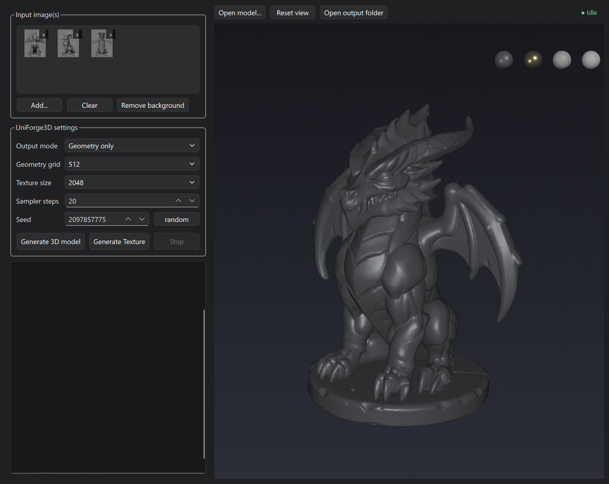

# UniForge3D UI — Windows Desktop Edition

A Windows-focused packaging of [UniForge3D](https://github.com/xibushu/UniForge3D) with a
PySide6 desktop UI (`PS6_UI/`). Generates textured 3D assets (GLB) from sparse, unposed
multi-view images. Apache-2.0, same as upstream.

## Requirements

- Windows 10/11, NVIDIA GPU (CUDA 13.0 wheels)
- [Python 3.12 x64](https://www.python.org/downloads/) (`py -3.12` must work)
- The prebuilt `.whl/` folder (included) — no native builds needed, but the wheels can also be built from source if you prefer. It includes custom `cumm-cu130` / `spconv-cu130` builds for Hi3D; the PyPI spconv wheels have no Blackwell (sm_120) kernels.

## Setup

<table>
  <tr>
    <th width="25%">Step</th>
    <th width="75%">UI</th>
  </tr>
  <tr>
    <td valign="top"><code>install.bat</code> — create <code>.venv</code>, install pinned requirements + local wheels<br><br><code>get_models.bat</code> — download model weights into <code>models\&lt;owner&gt;\&lt;repo&gt;\</code><br><br><code>start_UI.bat</code> — launch the desktop UI</td>
    <td valign="top"></td>
  </tr>
</table>

Run in that order. `get_models.bat` fetches from public Hugging Face and ModelScope
mirrors and is resumable — re-run it if a download is interrupted. `start_UI.bat`
auto-detects the model tree and applies VRAM safeguards. Vendored source checkouts
(`uniforge3d`, `CelloCut`, `Hi3Dv1.0`, `LATO.2`) live under `submodules/`.

## Tools & viewer

All repair, upscale and retopology tools operate on the **displayed model**,
and save their results next to it.

<table width="100%">
  <tr>
    <th width="50%">Hi3D 1536 refinement (optional)</th>
    <th width="50%">CelloCut watertight repair (optional)</th>
  </tr>
  <tr>
    <td width="50%" valign="top">
      <ul>
        <li><strong>Run
        <a href="https://github.com/hi3d-official/Hi3Dv1.0">Hi3D 1536</a></strong>
        refines the displayed mesh with Hi3D v1.0, conditioned on the
        <strong>REF</strong> image (falls back
        to the run's first image; after <strong>Open folder</strong> you pick
        one).</li>
        <li>Passes: <strong>1-3</strong> runs the full 64 → 128 → 192 ladder
        (output 1536); <strong>2-3</strong> re-voxelizes the displayed mesh at
        128; <strong>1</strong>/<strong>2</strong>/<strong>3</strong> run one
        rung (512/1024/1536).</li>
        <li>Saved as <code>&lt;model&gt;_hi3d_&lt;resolution&gt;.glb</code>;
        geometry only. <strong>Run 2nd stage</strong> upscales the displayed
        mesh to 1024, using its <code>.shape512.pt</code> state when
        present.</li>
        <li>Knobs: <strong>Steps</strong> (default 25),
        <strong>Voxel budget</strong> (100% = 80k/90k/110k) and
        <strong>Full GPU</strong> (faster, much higher VRAM; otherwise
        follows Low VRAM).</li>
        <li>Uses <code>submodules/Hi3Dv1.0/</code> or
        <code>UNIFORGE_HI3D_SOURCE</code>; <code>get_models.bat</code>
        downloads ~10.7 GB (Hi3D + DINOv2 + CLIP). Output is unit-normalized,
        and 1536 remains VRAM-heavy.</li>
      </ul>
    </td>
    <td width="50%" valign="top">
      <ul>
        <li><strong>Run
        <a href="https://github.com/rangeryx-66/CelloCut">CelloCut</a></strong>
        rebuilds the displayed mesh as a watertight solid from a 512³ UDF and
        graph-cut; constructive, no model download.</li>
        <li>Saves <code>&lt;model&gt;_cellocut.glb</code> and
        <code>&lt;model&gt;_cellocut.shape512.pt</code> next to the untouched
        source; Run 2nd stage and Hi3D can continue from it.</li>
        <li>Compiled extensions ship in <code>.whl/</code>
        (<code>torchcumesh2sdf</code>, <code>cppmodules</code>).</li>
      </ul>
    </td>
  </tr>
  <tr>
    <th width="50%">LATO.2 retopology (optional)</th>
    <th width="50%">Viewer</th>
  </tr>
  <tr>
    <td width="50%" valign="top">
      <ul>
        <li><strong>Run LATO.2</strong> retopologizes the displayed mesh with
        <a href="https://github.com/LoHhhha/LATO.2">LATO.2</a> (V-Flow +
        T-Flow) at a target vertex count.</li>
        <li>Saves <code>&lt;model&gt;_lato2.glb</code> plus
        <code>&lt;model&gt;_lato2.shape512.pt</code>; geometry only.
        The source lives in <code>submodules/LATO.2</code>;
        <code>get_models.bat</code> fetches its checkpoints.</li>
        <li>The <code>Remesh_LATO2:</code> panel has
        <strong>fill quad rings</strong> and <strong>drop small patches</strong>
        toggles; clean leftover holes with <strong>Close Holes</strong>.</li>
      </ul>
    </td>
    <td width="50%" valign="top">
      <ul>
        <li><strong>Open folder</strong> fills the Outliner with every
        <code>*.glb</code>; click to display it in place (camera and material
        kept). Derived models nest under their base, and the arrow on any row
        collapses its branch.</li>
        <li>Right-click: <strong>Rename...</strong>, <strong>Show obj</strong>
        (selects the matching <code>.obj</code> in Explorer),
        <strong>Duplicate</strong>, <strong>Delete</strong>. Middle-click
        ghosts a model for comparison/Reproject.</li>
        <li><strong>View</strong> menu: Reset view and Backface culling (on by
        default). Culling makes flipped patches and holes see-through — useful
        before CelloCut or refinement.</li>
      </ul>
    </td>
  </tr>
</table>

## Credits & License

This is a third-party UI/packaging fork. All model and pipeline code comes from the
original **[UniForge3D](https://github.com/xibushu/UniForge3D)** repo, which builds on
[TRELLIS.2](https://github.com/microsoft/TRELLIS.2) and
[VGGT](https://github.com/facebookresearch/vggt):

- Upstream repo: [github.com/xibushu/UniForge3D](https://github.com/xibushu/UniForge3D)
- Project page: [xishuxishu.github.io/uniforge3d-project](https://xishuxishu.github.io/uniforge3d-project/)
- Models: [huggingface.co/xibushu/UniForge3D](https://huggingface.co/xibushu/UniForge3D)
- Paper: [arXiv:2610.15357](https://arxiv.org/abs/2610.15357)

### License

- **Everything else** (this UI, the packaging, and upstream UniForge3D):
  [Apache License 2.0](LICENSE), matching the upstream project.
- **Vendored VGGT code** (`submodules/uniforge3d/models/vggt/`): VGGT's
  [CC BY-NC 4.0](https://github.com/facebookresearch/vggt/blob/main/LICENSE.txt) —
  non-commercial use only.
- **BRIA RMBG-2.0** (background removal weights fetched by `get_models.bat`):
  BRIA's [custom license](https://huggingface.co/briaai/RMBG-2.0) — free for
  non-commercial use; commercial use requires a license from BRIA AI.
- **Hi3D v1.0** (`submodules/Hi3Dv1.0/` source and the `hi3d-official/Hi3Dv1.0` weights):
  the [Hi3D Open License Agreement Version 1.0](submodules/Hi3Dv1.0/LICENSE). Commercial
  use is permitted below its scale threshold (200,000 MAU / USD 1M monthly
  revenue); commercial integrations must display **Powered by Hi3D 1.0**
  linking to [hi3d.ai](http://hi3d.ai/).
- **DINOv2-large** ([facebook/dinov2-large](https://huggingface.co/facebook/dinov2-large))
  and **CLIP ViT-L/14** ([openai/clip-vit-large-patch14](https://huggingface.co/openai/clip-vit-large-patch14)):
  third-party encoders used only by Hi3D, under their respective model licenses.
- **spconv** and **cumm** (Hi3D dependencies): Apache License 2.0. The wheels in
  `.whl/` are local CUDA 13 / sm_120 builds of spconv 2.3.8 and cumm 0.8.2.

Please cite the original paper if you use this work:

```bibtex
@article{chen2026uniforge3d,
  title   = {UniForge3D: Joint 3D Reconstruction and Generation in a Shared Anchor-Guided Space},
  author  = {Chen, Wenjue and Chen, Wenyue and Zheng, Heliang and Jia, Rongfei and Liu, Yuan and Li, Meng},
  journal = {arXiv preprint arXiv:2610.15357},
  year    = {2026}
}
```
